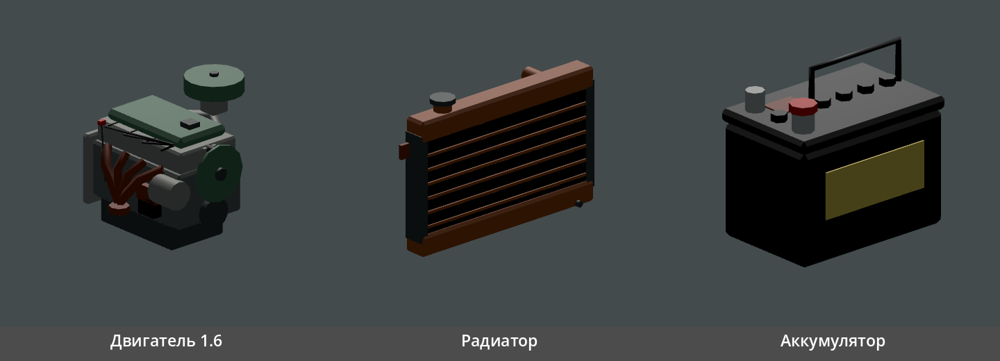
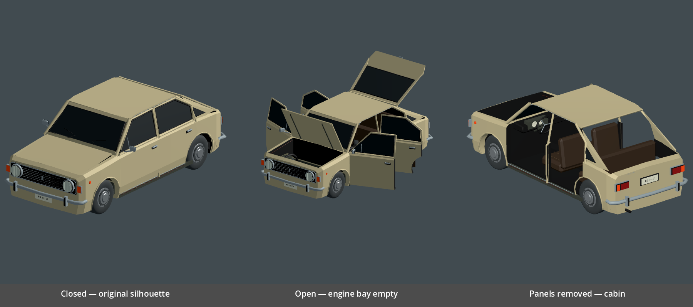
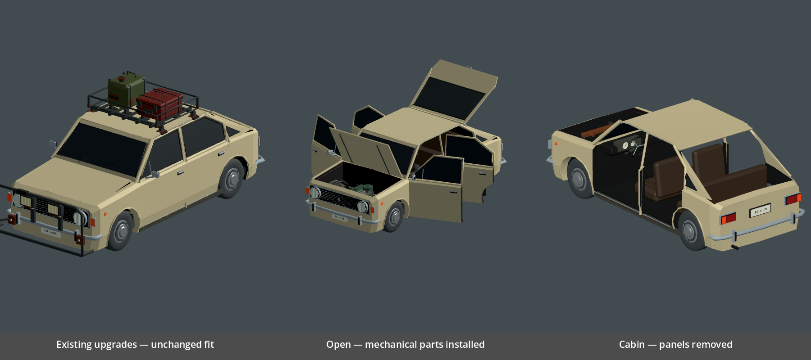

# Машина из деталей: арт

Контракт — `docs/ADR/0003-car-assembly.md`, п. 7–8. Задания — `docs/TASKS.md`,
раздел «Арт-модель» (B1–B4).

## Детали (B2) — сделано архитектором 2026-10-26

Арт-модель была на лимите; детали отдельные и с её работой не пересекаются,
поэтому их сделал архитектор тем же способом, что навесы улучшений: генератор
на функциях из начала `tools/blender_zastava.py`, один меш и один материал с
цветами вершин, палитра включается при импорте (`WorldPropImport.gd`).
Арт-модель может переделать их по-своему — код от этого не зависит.

| Файл (`game/assets/models/parts/`) | Треугольников | Бюджет | Габарит, м (X × Y × Z) |
|---|---|---|---|
| `part_engine_1_6.glb` | 884 | 1500 | 0,51 × 0,47 × 0,48 |
| `part_radiator_std.glb` | 368 | 500 | 0,66 × 0,42 × 0,14 |
| `part_battery_std.glb` | 340 | 400 | 0,27 × 0,25 × 0,18 |

- Начало координат — точка крепления в гнезде: деталь стоит на нём, по центру.
- Перед детали — −Z, как у машины: шкивы и вентилятор двигателя, сердцевина
  радиатора; клеммы аккумулятора — к +X.
- Двигатель нарисован в «натуральную» величину и уменьшен (×0,72), чтобы
  влезть под капот Zastava 101: от гнезда до капота около 0,5 м. Если оболочка
  B1 даст больше места — масштаб в `builders` генератора.
- Коллизий, света и анимаций нет: тело для детали в руках и на полу делает код.

```powershell
blender --background --python tools/blender_car_parts.py
godot --headless --path game --import
godot --headless --path game --script ../tools/car_parts_check.gd
godot --path game --rendering-method gl_compatibility --script ../tools/car_parts_review.gd
```

Исходник — `art/blender/parts/car_parts.blend`, бюджеты — `art/blender/parts/geometry.json`.
В игре: `--check-car-assembly` (в `check.ps1`) проверяет, что в гнёздах стоят
модели, а не заглушки.



## Кузов из деталей и гараж (B1, B3) — арт-модель

B1/B4 готовы: оболочка, шесть панелей, салон и моторный отсек.
Гараж B3 — `PLAYER_HOUSE_ART.md`. Передача модели фич — `B1_FEATURE_HANDOFF.md`.

Все новые GLB лежат в `game/assets/models/cars/`:

| Файл | Треугольники экспорта |
|---|---:|
| `zastava_101_shell.glb` | 3008 |
| `zastava_101_door_fl.glb` | 444 |
| `zastava_101_door_fr.glb` | 444 |
| `zastava_101_door_rl.glb` | 405 |
| `zastava_101_door_rr.glb` | 405 |
| `zastava_101_hood.glb` | 36 |
| `zastava_101_trunk.glb` | 174 |

Всего 4916 треугольников без колёс, агрегатов и навесов; после импорта
Godot — 4872 (удаляются вырожденные грани). Бюджет 5000. На файл один меш
и один материал с цветами вершин. Стёкла тёмные непрозрачные, как у исходной
машины. Коллизий и скриптов в GLB нет.

Оболочка — в системе шасси прежней Zastava: метры, +Y вверх, перед −Z.
Ноль кузова **не на земле**. Исходный кузов, колесо, CarSpec и навесы не менялись.
Есть сиденья, приборы, руль, рычаг, коврики, дверные карты и усилители панелей.
Багажник — подъёмная пятая дверь хэтчбека со стеклом.

Закрытые гнёзда без поворота и масштаба; координаты относительно шасси:

| `Socket_<id>` | X | Y | Z |
|---|---:|---:|---:|
| engine | 0 | −0.27 | −1.31 |
| radiator | 0 | −0.26 | −1.69 |
| battery | −0.49 | −0.155 | −1.17 |
| door_fl / door_fr | −0.74 / +0.74 | −0.03 | −0.85 |
| door_rl / door_rr | −0.74 / +0.74 | −0.03 | +0.19 |
| hood | 0 | +0.342 | −0.93 |
| trunk | 0 | +0.785 | +0.90 |
| wheel_fl / wheel_fr | −0.65 / +0.65 | −0.295 | −1.2245 |
| wheel_rl / wheel_rr | −0.65 / +0.65 | −0.295 | +1.2245 |

У шести панелей есть `Open_<id>`: та же позиция петли; поворот вокруг Y
−70° у левых дверей, +70° у правых; вокруг X +70° у капота, −65° у багажника.
Начало отдельного GLB — в петле; корень и меш с единичными трансформами.
**Ставить панель трансформом гнезда, без дополнительного смещения.**
`Open_` — конечное положение в системе кузова, не прибавка к `Socket_`.

Генератор `tools/blender_zastava_modular.py` использует исходную геометрию
только в памяти и пишет лишь семь новых GLB. Редактируемый исходник —
`art/blender/zastava-modular/zastava_modular.blend`, цифры — `geometry.json`.
В Blender панели стоят на машине; генератор переносит их начало в петлю
при экспорте. Исходник хранит геометрию до оптимизации игрового меша.

`tools/car_parts_check.gd` проверяет B2 и B1: 13 гнёзд, 6 открытых положений,
углы, неподвижность петель, начала панелей, бюджет и отсутствие коллизий.
Целевой прогон прошёл: `failures=0`.

```powershell
blender --background --python tools/blender_zastava_modular.py
godot --headless --path game --import
godot --headless --path game --script ../tools/car_parts_check.gd
godot --path game --rendering-method gl_compatibility --script ../tools/zastava_modular_review.gd
godot --path game --rendering-method gl_compatibility --script ../tools/zastava_modular_review.gd -- --fitted
```




