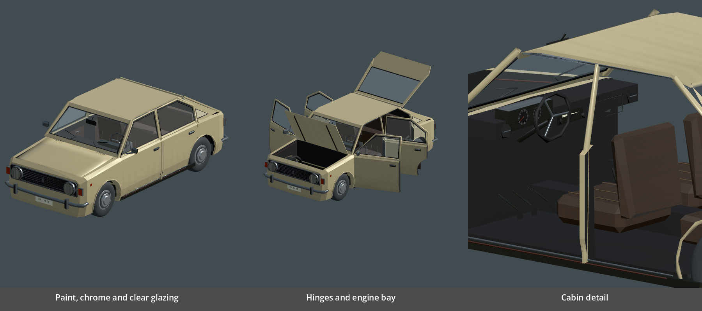
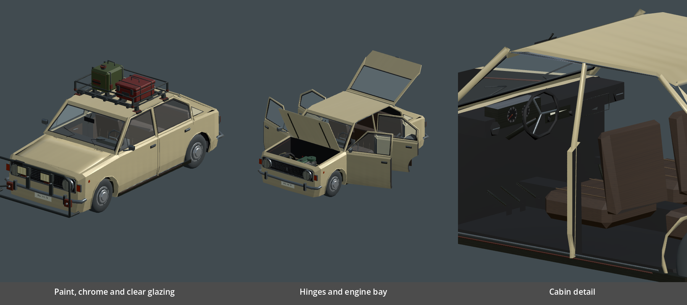

# Детализация Zastava 101

Ветка `art/zastava-detail`, следующий арт-проход после B1. Меняются те же
семь модульных GLB; имена, масштаб, все Socket/Open и нули панелей сохранены.
Цельный резервный кузов и отдельное колесо не перезаписывались. Код механик
и освещения в `game/scripts` не менялся.

## Результат

- Капот получил поперечную выпуклость и две штампованные линии. Двери —
  тонкие уплотнения и швы. Габариты, арки и посадка навесов сохранены.
- Разделены краска, металл, интерьер и стекло. Вместо одинаковой реакции
  на свет — разные metallic/roughness. Стёкла полупрозрачные, с видимым салоном.
- Детерминированные авторские атласы: выцветание, загрязнение нижней части,
  мелкие очаги коррозии, зерно обивки и металла, печатные шкалы приборов.
  Фотографии не включены в текстуры. Износ статический, не отражает прочность
  детали или результат ремонта.
- В салоне добавлены радио, круглые вентиляционные отверстия, бардачок,
  педали, зеркало, внутренние ручки и строчки дверных карт.

Это более подробная стилизованная модель, а не точная реставрационная копия.
Указатели приборов пока нарисованы на текстуре и не показывают скорость/топливо.
Настоящие источники света фар остаются ответственностью сцены.





Референсы формы: [перед ранней Zastava 1973](https://www.njuskalo.hr/auti/zastava-101-101-oglas-15647005),
[фотографии салона](https://autosalon.tv/novinky/retro/retro-otestovali-jsme-jugoslavskou-zastavu-101-kultovni-vuz-strci-vsechny-skodovky-do-kapsy).
Фото использованы только для визуальной сверки отдельных деталей.

## Цена и воспроизводимость

| Метрика собранного кузова без колёс/агрегатов/навесов | B1 | Сейчас |
|---|---:|---:|
| Треугольники экспорта | 4916 | 4718 |
| Треугольники после импорта | 4872 | 4672 |
| Меши | 7 | 7 |
| Поверхности | 7 | 26 |
| Поверхности с прозрачностью | 0 | 6 |

Текстуры: два атласа 1024×1024, albedo и roughness. Каждый GLB самодостаточен
и содержит их внутри (около 1,3 МБ на панель; семь GLB около 9,1 МБ).
Импорт `gltf/embedded_image_handling=2` хранит встроенные текстуры со сжатием
Basis Universal, без распаковки PNG рядом с GLB. Значения режимов описаны в
[документации Godot](https://docs.godotengine.org/en/latest/classes/class_gltfstate.html#enum-gltfstate-handlebinaryimagemode).
Одинаковые изображения могут занимать отдельные ресурсы в разных GLB —
фактическое потребление VRAM нужно мерить в игровой сцене.

Генератор: `tools/blender_zastava_modular.py`, стадия детализации и экспорта —
`tools/blender_zastava_finish.py`. Текстуры и упакованный редактируемый `.blend`
лежат в `art/blender/zastava-modular/`. `gltf_vertex_palette.py` нормализует
канал COLOR_0: Blender при экспорте текстуры добавляет белый COLOR_0, а
настоящую палитру кладёт в COLOR_1. Проверка ловит потерю цветовой палитры.

Отдельный импортёр `game/assets/materials/zastava_import.gd` применяется
только к семи новым GLB. Он сохраняет PBR-текстуры и alpha стекла, включает
цвета вершин. Общий `WorldPropImport.gd` не менялся: он сбрасывает albedo
в белый вместе с alpha и поэтому не подходит для этих стёкол.

```powershell
blender --background --python tools/blender_zastava_modular.py
godot --headless --path game --import
godot --headless --path game --script ../tools/car_parts_check.gd
godot --path game --rendering-method gl_compatibility --script ../tools/zastava_modular_review.gd -- --detail
godot --path game --rendering-method gl_compatibility --script ../tools/zastava_modular_review.gd -- --detail --fitted
```

Снимки используют стандартное небо для отражений материалов; это стенд
просмотра ассетов, а не обещание такого же света в гараже. Итоговую картинку
следует принять при игровом дневном и ночном освещении.

## Приёмка цены — архитектор, 2026-10-26

Тот же код (`master` fdb008e + `--perf-car`), меняются только семь GLB:
B1 (f8d2f4b) против детализации. GTX 1060, окно 2560×1080 (настройки игры
растянули окно на монитор; на 33 % больше пикселей, чем 1080p), по 2 прогона.

| Сцена | Метрика | B1 | Детализация |
|---|---|---:|---:|
| `--perf-car` (машина крупно, закрыта) | кадр / видеокарта | 4,23 / 3,70 мс | 4,38 / 3,82 мс |
| `--perf-car --open=all` | кадр / видеокарта | 4,26 / 3,74 мс | 4,39 / 3,85 мс |
| `--perf` (обычная езда) | кадр / видеокарта | 5,55 / 5,00 мс | 5,58 / 5,03 мс |
| машина крупно | вызовы отрисовки | 113 | 145 |
| всё | память текстур | 160 МБ | 213 МБ |
| всё | видеопамять | 229 МБ | 289 МБ |

**Принято.** Кадр +0,15 мс в крупном плане и в шуме при езде; 26 поверхностей
и 6 прозрачных стёкол стоят +32 вызова отрисовки (бюджет 1500). Сортировка
прозрачности заметной цены не даёт — отдельно её не трогаем.

**Дорого одно: +53 МБ текстур на одну машину.** Два атласа 1024² в сжатом
виде — около 3 МБ; 53 МБ значат, что каждый из семи GLB держит свою копию
атласов (14 текстур вместо двух) и, похоже, не в сжатом формате видеокарты.
Сейчас это укладывается в бюджет 2 ГБ, но такая же детализация ВАЗа, Golf и
навесов даст сотни мегабайт. Задание арту (не срочное) — `docs/TASKS.md`, B5:
атласы — отдельными файлами, общими для семи GLB, с VRAM-сжатием; цель —
память текстур машины ≤ 10 МБ, проверка тем же замером.

```powershell
godot --resolution 1920x1080 --path game -- --perf --perf-car [--open=all]
```

## Промпт модели фич

Прочитай `AGENTS.md`, `docs/ARCHITECTURE.md`, `docs/ZASTAVA_DETAIL.md` и
`docs/CAR_PARTS_ART.md`. Арт обновил семь GLB Zastava, контракт сборки прежний.
Проверь отображение в игре днём, ночью и из водительской камеры: виден салон
через окна, окна не превращаются в белые/чёрные пластины, обводка снятых и
открытых панелей работает. Не заменяй PBR-материалы одним общим материалом.
Убедись, что alpha сохраняется при любой обработке материалов в коде.

Проверь сборку/снятие/сейв, новые навесы и подъём кузова на подвеске. Для фар
используй существующие световые узлы сцены; дополнительный свет добавляй
только если визуальная проверка выявит проблему, не встраивай свет в GLB.
Статические шкалы сейчас декоративные — динамические приборы отдельная задача.
Перед слиянием своего подключения — полный `tools/check.ps1`.
В ответе: коммит, результаты, снимок из салона и один вечерний снаружи;
ошибки геометрии передать арту одним списком с ракурсами.

## Промпт архитектору

Прочитай `docs/ZASTAVA_DETAIL.md`. Нужна приёмка цены новых материалов:
26 поверхностей вместо 7, шесть прозрачных, два встроенных атласа 1024².
Треугольники уменьшились, контракт Socket/Open не изменился.
Сравни базовый `master` до этой ветки и новый в одинаковой сцене при 1920×1080:
`--perf` у машины с закрытыми/открытыми панелями, кадр CPU/GPU, draw calls,
VRAM; бюджет ≤8 мс. По ADR 0003 §9 замер производительности — архитектору.
Если цена заметна, сначала проверь повторное хранение одинаковых текстур
между GLB и сортировку прозрачности; предложи общий кеш ресурсов/дальность
детализации. Не склеивай снимаемые панели со статическим кузовом и не меняй
начала деталей. Сообщи цифры до/после и необходимость следующего арт-исправления.
